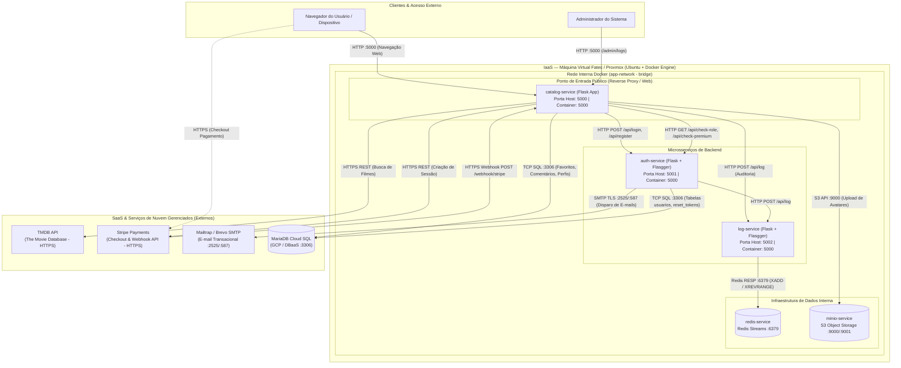
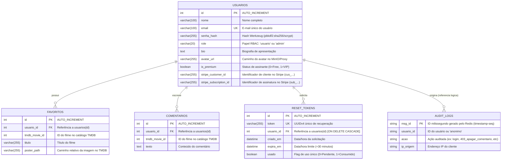

# 📚 Documentação Reversa do Sistema — Catálogo Tom Hanks

> **Projeto:** Catálogo de Filmes Tom Hanks & Ecossistema de Microsserviços  
> **Disciplina:** ISW055 — Laboratório de Desenvolvimento Web / Engenharia de Software  
> **Professor Responsável:** [@siriani](https://github.com/siriani)  
> **Repositório:** [Catálogo Tom Hanks](https://github.com/siriani)  
> **Documento:** Documentação Reversa de Especificação, Arquitetura, Regras de Negócio e Modelo de Dados  

---

## 🧭 Sumário

1. [Visão Geral e Contexto](#1-visão-geral-e-contexto)
2. [Documentação Reversa — Especificação Funcional (Visão do Usuário)](#2-documentação-reversa--especificação-funcional)
   - [2.1 Cadastro, Autenticação e Sessão](#21-cadastro-autenticação-e-sessão)
   - [2.2 Recuperação de Senha com E-mail Transacional](#22-recuperação-de-senha-com-e-mail-transacional)
   - [2.3 Catálogo de Filmes (TMDB)](#23-catálogo-de-filmes-tmdb)
   - [2.4 Sistema de Favoritos e Desfavoritar](#24-sistema-de-favoritos-e-desfavoritar)
   - [2.5 Comentários e Moderação](#25-comentários-e-moderação)
   - [2.6 Perfil Social e Upload de Avatar (Object Storage)](#26-perfil-social-e-upload-de-avatar-object-storage)
   - [2.7 Plano Premium e Checkout de Assinatura (Stripe)](#27-plano-premium-e-checkout-de-assinatura-stripe)
   - [2.8 Painel de Auditoria e Logs (Exclusivo Admin)](#28-painel-de-auditoria-e-logs-exclusivo-admin)
   - [2.9 Documentação Interativa de APIs (Swagger/OpenAPI)](#29-documentação-interativa-de-apis-swaggeropenapi)
3. [Documentação Reversa — Arquitetura de Software e Infraestrutura](#3-documentação-reversa--arquitetura-de-software-e-infraestrutura)
   - [3.1 Visão Geral dos Microsserviços e Dependências](#31-visão-geral-dos-microsserviços-e-dependências)
   - [3.2 Diagrama Arquitetural Completo (Big Picture)](#32-diagrama-arquitetural-completo-big-picture)
   - [3.3 Topologia de Rede e Portas](#33-topologia-de-rede-e-portas)
   - [3.4 Protocolos e Padrões de Comunicação](#34-protocolos-e-padrões-de-comunicação)
4. [Documentação Reversa — Regras de Negócio (Se X, então Y)](#4-documentação-reversa--regras-de-negócio-se-x-então-y)
   - [4.1 Autenticação, Contas e Segurança](#41-autenticação-contas-e-segurança)
   - [4.2 Recuperação de Senha e Tokens](#42-recuperação-de-senha-e-tokens)
   - [4.3 Autorização e Controle de Acesso Baseado em Papéis (RBAC)](#43-autorização-e-controle-de-acesso-baseado-em-papéis-rbac)
   - [4.4 Favoritos, Cotas e Plano Gratuito](#44-favoritos-cotas-e-plano-gratuito)
   - [4.5 Assinatura Premium, Checkout e Webhooks (Stripe)](#45-assinatura-premium-checkout-e-webhooks-stripe)
   - [4.6 Perfil do Usuário e Upload de Mídia (MinIO)](#46-perfil-do-usuário-e-upload-de-mídia-minio)
   - [4.7 Auditoria de Eventos (Redis Streams)](#47-auditoria-de-eventos-redis-streams)
5. [Documentação Reversa — Modelo de Dados](#5-documentação-reversa--modelo-de-dados)
   - [5.1 Diagrama Entidade-Relacionamento (DER)](#51-diagrama-entidade-relacionamento-der)
   - [5.2 Dicionário de Dados Relacional (MariaDB)](#52-dicionário-de-dados-relacional-mariadb)
   - [5.3 Estrutura de Dados NoSQL em Memória (Redis Streams)](#53-estrutura-de-dados-nosql-em-memória-redis-streams)
   - [5.4 Estrutura de Objetos e Metadados (MinIO S3)](#54-estrutura-de-objetos-e-metadados-minio-s3)
6. [Guia de Operação e Manutenção para Novos Mantenedores](#6-guia-de-operação-e-manutenção-para-novos-mantenedores)
   - [6.1 Variáveis de Ambiente](#61-variáveis-de-ambiente)
   - [6.2 Subindo o Ambiente Local](#62-subindo-o-ambiente-local)
   - [6.3 Execução de Testes Automatizados](#63-execução-de-testes-automatizados)

---

## 1. Visão Geral e Contexto

Este documento é fruto do processo de **documentação reversa** do sistema *Catálogo de Filmes - Tom Hanks*, construído ao longo da série de atividades pedagógicas:
$$\text{Agenda} \longrightarrow \text{Catálogo} \longrightarrow \text{Login} \longrightarrow \text{RBAC} \longrightarrow \text{Logs} \longrightarrow \text{Perfil} \longrightarrow \text{Premium (Stripe)}$$

O sistema iniciou-se como um monólito e evoluiu para uma **arquitetura de microsserviços distribuída**, isolando responsabilidades de autenticação, catálogo/apresentação, auditoria, armazenamento de objetos e cobrança recorrente.

Este documento atua como o manual definitivo para qualquer engenheiro de software que assuma a manutenção ou evolução desta base de código.

---

## 2. Documentação Reversa — Especificação Funcional

A especificação a seguir descreve as capacidades do sistema sob a ótica do usuário final (visitante, usuário autenticado gratuito, assinante premium e administrador).

### 2.1 Cadastro, Autenticação e Sessão
- **Visitante não autenticado:**
  - Acessa as telas `/login` e `/register`.
  - Qualquer tentativa de acessar a tela inicial (`/`), favoritos, perfil ou painel admin sem credenciais válidas resulta em redirecionamento forçado para `/login`.
- **Cadastro (`/register`):**
  - O usuário informa `Nome`, `E-mail` e `Senha`.
  - O sistema valida preenchimento e unicidade do e-mail.
  - Ao registrar, o usuário ganha automaticamente o papel de `usuario` (plano gratuito não-premium).
- **Login (`/login`):**
  - Usuário digita `E-mail` e `Senha`.
  - Caso válidos, o sistema cria uma sessão web criptografada com cookie assinado via `SECRET_KEY`, guardando `user_id`, `nome`, `role`, `avatar_url` e `is_premium`.
- **Logout (`/logout`):**
  - Destrói a sessão no cliente e servidor, emitindo log de auditoria e redirecionando para a tela de login.

### 2.2 Recuperação de Senha com E-mail Transacional
- **Esqueci minha senha (`/forgot-password`):**
  - O usuário informa seu e-mail cadastrado.
  - O sistema gera um token pseudo-aleatório UUIDv4 seguro com validade de 30 minutos e status `usado = 0`.
  - Um e-mail com layout HTML responsivo e link transacional seguro é despachado via SMTP (Mailtrap em desenvolvimento ou Brevo em homologação/produção).
  - O sistema responde de forma neutra ("Se o e-mail estiver cadastrado, você receberá o link...") para evitar ataques de força bruta de enumeração de contas.
- **Redefinição (`/reset-password/<token>`):**
  - Ao acessar o link, o sistema verifica a validade do token (existência, se não foi utilizado e se está dentro da janela de 30 minutos).
  - Se válido, exibe o formulário de nova senha.
  - Ao enviar a nova senha, o hash da senha é atualizado no banco, o token é marcado como `usado = 1` e novo acesso com o mesmo token é permanentemente bloqueado.

### 2.3 Catálogo de Filmes (TMDB)
- **Página Inicial (`/`):**
  - Consulta a API pública do The Movie Database (TMDB) buscando o cadastro do ator Tom Hanks e recuperando sua filmografia completa (`movie_credits`).
  - Renderiza uma galeria de cartões (cards) contendo pôster oficial, título original e traduzido, ano de lançamento, sinopse e média de votos.
  - Exibe para cada filme o estado atual em relação ao usuário (se já foi favoritado ou não) e os comentários postados por todos os usuários.

### 2.4 Sistema de Favoritos e Desfavoritar
- **Favoritar (`POST /favoritar`):**
  - O usuário clica no botão "Favoritar" de um filme.
  - O sistema grava a relação no banco com ID do filme, título e caminho da imagem de pôster.
- **Desfavoritar (`POST /desfavoritar`):**
  - Permite ao usuário remover um filme da sua lista de favoritos, liberando espaço em sua cota caso esteja no plano gratuito.
- **Cota de Favoritos (Diferenciação Freemium):**
  - Usuários gratuitos possuem limite de **até 5 filmes favoritos**.
  - Assinantes Premium possuem **favoritos ilimitados**.

### 2.5 Comentários e Moderação
- **Comentar (`POST /comentar`):**
  - Qualquer usuário autenticado pode registrar comentários em qualquer filme da filmografia.
  - O comentário é exibido com o nome do autor abaixo do respectivo cartão do filme.
- **Exclusão de Comentários (`POST /apagar_comentario/<id>`):**
  - Usuário comum: só pode apagar os comentários que ele mesmo criou.
  - Administrador: possui poderes de moderação global, podendo apagar comentários de qualquer usuário.

### 2.6 Perfil Social e Upload de Avatar (Object Storage)
- **Visualização do Perfil (`GET /perfil/<id>`):**
  - Exibe dados públicos do usuário: avatar, nome, e-mail, biografia (bio), selo VIP (se for assinante Premium) e grade com todos os filmes favoritados por ele.
- **Edição do Perfil (`POST /perfil/<id>`):**
  - Apenas o dono da conta pode editar seu próprio perfil.
  - Permite alterar o nome de exibição, biografia textual e submeter uma foto de avatar.
  - A imagem é validada (extensões de imagem e tamanho máximo de 2MB), gravada em bucket S3 no MinIO, e seu link público é vinculado ao registro do usuário.

### 2.7 Plano Premium e Checkout de Assinatura (Stripe)
- **Benefícios da Assinatura:**
  - Remoção imediata do teto de 5 filmes favoritos (favoritos ilimitados).
  - Selo visual VIP Dourado (`⭐ VIP PREMIUM`) exibido na barra superior e no perfil social.
- **Fluxo de Checkout (`GET /checkout`):**
  - Redireciona o usuário para página de pagamento hospedada pelo Stripe em ambiente de teste seguro.
  - Nenhum dado de cartão de crédito passa pelo servidor da aplicação (conformidade total com PCI-DSS).
- **Confirmação Assíncrona via Webhook (`POST /webhook/stripe`):**
  - O Stripe notifica o backend via webhook assinado criptograficamente.
  - Ao confirmar `checkout.session.completed`, o usuário é promovido a `is_premium = 1`.
  - Em caso de cancelamento da assinatura (`customer.subscription.deleted`), o usuário é automaticamente revertido para o plano gratuito (`is_premium = 0`).

### 2.8 Painel de Auditoria e Logs (Exclusivo Admin)
- **Visualização dos Logs (`GET /admin/logs`):**
  - Rota protegida por RBAC acessível apenas por administradores.
  - Exibe tabela cronológica dos últimos 50 eventos registrados no Redis Streams (timestamp legível, ID do usuário ou anônimo, ação executada e endereço IP de origem).
  - Permite auditar tentativas de invasão, bloqueios de segurança HTTP 403, transações financeiras e ações administrativas.

### 2.9 Documentação Interativa de APIs (Swagger/OpenAPI)
- Os microsserviços internos disponibilizam interfaces interativas Swagger UI geradas com Flasgger para inspeção e testes de integração de suas rotas:
  - Auth Service: `http://localhost:5001/apidocs/`
  - Log Service: `http://localhost:5002/apidocs/`

---

## 3. Documentação Reversa — Arquitetura de Software e Infraestrutura

### 3.1 Visão Geral dos Microsserviços e Dependências

O sistema é composto por 3 microsserviços próprios, 2 serviços de infraestrutura conteinerizados e 3 dependências externas de nuvem:

1. **`catalog-service` (Catálogo / Portal Web):**
   - Aplicação Flask na porta `5000`.
   - Responsável pela renderização SSR (Server-Side Rendering) com Jinja2, orquestração de chamadas de negócio, integração direta com MinIO, Stripe e TMDB.
2. **`auth-service` (Autenticação e Identidade):**
   - Microsserviço Flask interno rodando na porta interna `5000` (exposta como `5001` no host para documentação Swagger).
   - Gerencia hashing de senhas, validação de login, papéis RBAC e envio de e-mails transacionais.
3. **`log-service` (Auditoria e Telemetria):**
   - Microsserviço Flask interno rodando na porta interna `5000` (exposta como `5002` no host para documentação Swagger).
   - Registra eventos append-only e consulta históricos em alta performance usando Redis Streams.
4. **`redis-service` (Armazenamento em Memória):**
   - Container baseado na imagem oficial `redis:alpine` na porta interna `6379`.
5. **`minio` (Object Storage S3-compatível):**
   - Container baseado em `elestio/minio:latest` com API na porta `9010` (interna `9000`) e console web na porta `9011` (interna `9001`).
6. **Provedores Externos (SaaS / DBaaS):**
   - **MariaDB Externo:** Banco relacional na nuvem (`35.226.64.52:3306`).
   - **Stripe API & Webhooks:** Plataforma de cobrança recorrente via HTTPS.
   - **Mailtrap / Brevo SMTP:** Gateway de e-mails transacionais.
   - **TMDB API:** Fornecedor de metadados cinematográficos.

---

### 3.2 Diagrama Arquitetural Completo (Big Picture)



---

### 3.3 Topologia de Rede e Portas

| Serviço / Container | Imagem Base | Portas do Host | Porta Interna Docker | Finalidade |
| :--- | :--- | :--- | :--- | :--- |
| **`catalog-service`** | Dockerfile local (Python 3.10-slim) | `5000:5000` | `5000` | Ponto de entrada público da interface web e webhooks |
| **`auth-service`** | Dockerfile local (Python 3.10-slim) | `5001:5000` | `5000` | Microsserviço de autenticação e documentação Swagger |
| **`log-service`** | Dockerfile local (Python 3.10-slim) | `5002:5000` | `5000` | Microsserviço de auditoria e documentação Swagger |
| **`redis-service`** | `redis:alpine` | Nenhuma (fechada) | `6379` | Armazenamento de streams de log em memória |
| **`minio`** | `elestio/minio:latest` | `9010:9000`, `9011:9001` | `9000, 9001` | API S3 de arquivos e console web administrativo |
| **MariaDB (GCP)** | Gerenciado na nuvem | Host externo | `3306` | Banco de dados relacional compartilhado |

---

### 3.4 Protocolos e Padrões de Comunicação

1. **HTTP/REST Síncrono Interno:**
   - O `catalog-service` comunica-se com o `auth-service` para verificar credenciais e validar papéis em tempo de execução via `GET /api/check-role/<user_id>` (**Padrão A de Autorização Centralizada**).
   - O `catalog-service` e o `auth-service` disparam requisições assíncronas/desacopladas com timeout estrito de 2 segundos para `POST /api/log` do `log-service`.
2. **S3 Protocol (AWS SDK compatível):**
   - O `catalog-service` utiliza a biblioteca oficial `minio-py` para checar buckets, aplicar bucket policies e enviar arquivos via `put_object`.
3. **Redis Serialization Protocol (RESP):**
   - O `log-service` utiliza comandos de stream (`XADD` com auto-id e `XREVRANGE`) para garantia de ordem cronológica absoluta e leitura com paginação reversa.
4. **HTTPS Webhooks com Assinatura Criptográfica:**
   - O Stripe envia notificações assíncronas para o catálogo. O payload é verificado comparando o hash HMAC-SHA256 do cabeçalho `Stripe-Signature` contra o `STRIPE_WEBHOOK_SECRET`.
5. **SMTP com TLS:**
   - O `auth-service` abre conexões seguras autenticadas na porta 587 ou 2525 para envio de mensagens com envelopes alternativos (Plaintext + HTML).

---

## 4. Documentação Reversa — Regras de Negócio (Se X, então Y)

As regras a seguir foram extraídas diretamente da análise linha a linha do código-fonte ([`app.py`](file:///c:/Users/User/Downloads/tempo/Tom-Hanks-api/app.py), [`auth_service/app.py`](file:///c:/Users/User/Downloads/tempo/Tom-Hanks-api/auth_service/app.py) e [`log_service/app.py`](file:///c:/Users/User/Downloads/tempo/Tom-Hanks-api/log_service/app.py)):

### 4.1 Autenticação, Contas e Segurança
- **RN-01:** **Se** na submissão de cadastro (`/api/register`) qualquer um dos campos `nome`, `email` ou `senha` for nulo ou vazio, **então** o sistema rejeita a operação retornando código HTTP `400 Bad Request` com a mensagem `"Preencha todos os campos."`.
- **RN-02:** **Se** o `email` informado no cadastro já existir na tabela `usuarios`, **então** o MariaDB dispara uma violação de chave única (`IntegrityError`) e o serviço retorna HTTP `400` com `"E-mail já cadastrado."`.
- **RN-03:** **Se** um usuário é criado ou tem sua senha redefinida, **então** sua senha em texto puro é transformada em hash criptográfico unidirecional via `generate_password_hash()` antes de qualquer inserção ou atualização no banco.
- **RN-04:** **Se** na tentativa de login (`/api/login`) o par `email` e `senha` for validado com sucesso via `check_password_hash()`, **então** o sistema emite log `login`, responde com HTTP `200` e devolve o objeto do usuário (id, nome, email, role, avatar_url, is_premium).
- **RN-05:** **Se** o e-mail não existir ou a senha informada não corresponder ao hash, **então** o sistema emite log de auditoria `tentativa_login_falha` com o e-mail submetido e retorna HTTP `401 Unauthorized` com `"Credenciais inválidas."`.

### 4.2 Recuperação de Senha e Tokens
- **RN-06:** **Se** o usuário solicita redefinição de senha para um e-mail que **não** existe no banco, **então** o sistema retorna a mensagem de sucesso padrão (`"Se o e-mail estiver cadastrado, você receberá o link..."`), evitando revelar se o e-mail está cadastrado ou não.
- **RN-07:** **Se** o e-mail existir na solicitação de redefinição, **então** é criado um token UUIDv4 único na tabela `reset_tokens` com timestamp de expiração estritamente calculado como `criado_em + 30 minutos` e `usado = 0`.
- **RN-08:** **Se** um token de redefinição for verificado (`/api/verify-token`) e o campo `usado` for igual a `1`, **então** a operação é rejeitada informando `"Este link de redefinição já foi utilizado."`.
- **RN-09:** **Se** um token de redefinição for verificado e o horário atual for posterior a `expira_em` (`expira_em < datetime.now()`), **então** a requisição é recusada com `"Este link de redefinição expirou (válido por 30 minutos)."`.
- **RN-10:** **Se** a senha for alterada com sucesso via `/api/reset-password`, **então** o hash da nova senha é salvo no usuário e o token é atomizado com `usado = 1`, impedindo qualquer reutilização futura.

### 4.3 Autorização e Controle de Acesso Baseado em Papéis (RBAC)
- **RN-11:** **Se** um usuário não autenticado (`'user_id' not in session`) tentar acessar qualquer rota de negócio (`/`, `/favoritar`, `/desfavoritar`, `/comentar`, `/perfil/<id>`, `/checkout`, `/admin/logs`), **então** o sistema redireciona imediatamente para `/login` ou retorna HTTP `401`.
- **RN-12:** **Se** um usuário tentar apagar um comentário (`/apagar_comentario/<id>`), **então** o sistema verifica se ele é o autor original (`comentario.usuario_id == session['user_id']`). **Se não for o autor E seu papel consultado no auth-service não for `admin`**, **então** o backend bloqueia a ação, retorna código HTTP `403 Forbidden` com `"403 Forbidden - Você não tem permissão para apagar este comentário."` e emite log de auditoria `403_apagar_comentario_<id>`.
- **RN-13:** **Se** um usuário com papel de `admin` solicitar a exclusão de um comentário pertencente a qualquer usuário, **então** a exclusão é autorizada com sucesso (ação exclusiva de moderação) e o log `apagar_comentario_<id>` é persistido.
- **RN-14:** **Se** um usuário sem o papel de `admin` tentar acessar a rota `/admin/logs`, **então** o catálogo recusa a renderização com HTTP `403 Forbidden` e gera o evento de auditoria `403_acessar_logs`.

### 4.4 Favoritos, Cotas e Plano Gratuito
- **RN-15:** **Se** um usuário no plano gratuito (`is_premium == 0`) tentar favoritar um filme (`/favoritar`) e o total de registros existentes na tabela `favoritos` para seu `usuario_id` já for maior ou igual a `5`, **então** o sistema bloqueia a gravação, despacha o log `403_limite_favoritos_atingido` para o Redis e exibe alerta flash orientando o usuário a assinar o Plano Premium.
- **RN-16:** **Se** o usuário possuir o Plano Premium ativo (`is_premium == 1`), **então** a verificação de limite é ignorada, concedendo permissão para favoritar quantidade ilimitada de títulos.
- **RN-17:** **Se** o usuário tentar favoritar um filme que já consta em sua lista de favoritos, **então** a restrição de integridade do banco impede a duplicação e exibe mensagem amigável `"O filme já está na sua lista de favoritos."`.
- **RN-18:** **Se** o usuário submeter uma requisição de desfavoritar (`/desfavoritar`), **então** o filme é removido da tabela `favoritos` do respectivo usuário e um evento de log `desfavoritar_filme_<id>` é gerado, liberando espaço na cota gratuita.

### 4.5 Assinatura Premium, Checkout e Webhooks (Stripe)
- **RN-19:** **Se** um usuário já possui `is_premium == 1` e clica para assinar (`/checkout`), **então** o sistema impede a geração de uma nova cobrança e o redireciona ao seu perfil com aviso de que já é assinante VIP.
- **RN-20:** **Se** um usuário elegível inicia o checkout, **então** o backend gera uma `stripe.checkout.Session` com `mode='subscription'`, atrelando o `client_reference_id` e metadados ao `user_id` do usuário, e redireciona o navegador com código HTTP `303 See Other` para a página segura de pagamento hospedada pelo Stripe.
- **RN-21:** **Se** uma notificação HTTP POST chega ao endpoint de webhook (`/webhook/stripe`), **então** o cabeçalho `Stripe-Signature` deve ser validado via HMAC-SHA256 usando `STRIPE_WEBHOOK_SECRET`. **Se a assinatura for inválida ou o payload adulterado**, **então** o sistema rejeita a chamada com código HTTP `400 Bad Request`.
- **RN-22:** **Se** o webhook do Stripe confirma o evento `checkout.session.completed`, **então** o sistema recupera o `user_id`, atualiza o banco para `is_premium = 1`, grava os identificadores `stripe_customer_id` e `stripe_subscription_id`, e despacha log de auditoria `upgrade_premium_confirmado_<user_id>`.
- **RN-23:** **Se** o webhook do Stripe reportar cancelamento ou encerramento da assinatura (`customer.subscription.deleted` ou `customer.subscription.paused`), **então** o usuário correspondente tem seu status rebaixado para `is_premium = 0` e o evento `cancelamento_premium_assinatura_<sub_id>` é registrado.
- **RN-24:** **Se** ocorrer qualquer transação financeira, **então** sob nenhuma circunstância dados de cartão de crédito (números, validade ou CVV) são transmitidos, manipulados ou armazenados pelo banco de dados do sistema, atendendo às normas PCI-DSS.

### 4.6 Perfil do Usuário e Upload de Mídia (MinIO)
- **RN-25:** **Se** um usuário submeter alterações no perfil (`POST /perfil/<id>`) e o ID da rota for diferente do ID da sessão ativa (`session['user_id'] != user_id`), **então** o sistema rejeita a operação com código HTTP `403 Forbidden` e emite o log `403_editar_perfil_<id>`.
- **RN-26:** **Se** no envio de avatar o arquivo possuir extensão diferente de `png`, `jpg`, `jpeg`, `gif` ou `webp`, **então** a requisição é cancelada com alerta de tipo de arquivo não permitido.
- **RN-27:** **Se** o tamanho do arquivo de imagem enviado exceder o limite de 2 megabytes (`len(file_data) > 2 * 1024 * 1024`), **então** o upload é abortado com mensagem flash `"A imagem deve ter no máximo 2MB."`.
- **RN-28:** **Se** a imagem passar em todas as validações, **então** é gerado um nome imutável e único no formato `avatar_<user_id>_<uuid4_hex>.<ext>`, enviado ao bucket `perfil-fotos` no MinIO com política de leitura pública, e a rota de acesso do avatar é persistida no MariaDB.

### 4.7 Auditoria de Eventos (Redis Streams)
- **RN-29:** **Se** qualquer ação relevante for executada no sistema (login, logout, favoritar, desfavoritar, comentar, apagar comentário, editar perfil, início/retorno/webhook do Stripe ou bloqueios HTTP 403), **então** uma requisição POST é disparada para o `log-service` contendo `usuario_id`, `acao` e `ip_origem`.
- **RN-30:** **Se** o `log-service` receber os dados de auditoria, **então** ele utiliza o comando Redis `XADD audit_logs * ...` para inserir a entrada no stream com timestamp gerado automaticamente em nível de milissegundo.
- **RN-31:** **Se** um administrador consultar os logs (`/admin/logs`), **então** o `log-service` executa o comando `XREVRANGE audit_logs + - COUNT 50`, garantindo a leitura dos eventos mais recentes primeiro.
- **RN-32:** **Se** o serviço de log ou o Redis estiverem momentaneamente indisponíveis, **então** a aplicação principal captura a exceção em bloco `try/except` silencioso/logado sem interromper a navegação do usuário final.

---

## 5. Documentação Reversa — Modelo de Dados

### 5.1 Diagrama Entidade-Relacionamento (DER)



---

### 5.2 Dicionário de Dados Relacional (MariaDB)

#### Tabela: `usuarios`
Armazena a identidade do usuário, credenciais criptografadas, dados do perfil social e estado da assinatura no Stripe.

| Coluna | Tipo | Nulo | Padrão | Descrição |
| :--- | :--- | :---: | :---: | :--- |
| `id` | `INT` | Não | Auto-Inc | Chave primária do usuário |
| `nome` | `VARCHAR(100)` | Não | — | Nome completo do usuário |
| `email` | `VARCHAR(100)` | Não | — | E-mail corporativo/pessoal (Índice Único) |
| `senha_hash` | `VARCHAR(255)` | Não | — | Hash seguro gerado por biblioteca criptográfica |
| `role` | `VARCHAR(20)` | Não | `'usuario'` | Papel no controle de acesso (`'usuario'` ou `'admin'`) |
| `bio` | `TEXT` | Sim | `NULL` | Biografia descritiva do perfil do usuário |
| `avatar_url` | `VARCHAR(255)` | Sim | `NULL` | URI da foto de perfil hospedada no MinIO |
| `is_premium` | `BOOLEAN` | Não | `0` | Indicador de assinatura ativa (0 = Free, 1 = Premium) |
| `stripe_customer_id` | `VARCHAR(255)` | Sim | `NULL` | ID do cliente no painel do Stripe (`cus_...`) |
| `stripe_subscription_id` | `VARCHAR(255)` | Sim | `NULL` | ID da assinatura recorrente no Stripe (`sub_...`) |

#### Tabela: `favoritos`
Registra os filmes da filmografia de Tom Hanks favoritados pelos usuários.

| Coluna | Tipo | Nulo | Padrão | Descrição |
| :--- | :--- | :---: | :---: | :--- |
| `id` | `INT` | Não | Auto-Inc | Chave primária da relação de favorito |
| `usuario_id` | `INT` | Não | — | Chave estrangeira referenciando `usuarios(id)` |
| `tmdb_movie_id` | `INT` | Não | — | Identificador oficial do filme no TMDB |
| `titulo` | `VARCHAR(255)` | Não | — | Título do filme no momento da gravação |
| `poster_path` | `VARCHAR(255)` | Sim | `NULL` | Caminho do cartaz do filme no TMDB |

#### Tabela: `comentarios`
Armazena as avaliações e observações textuais de usuários sobre os filmes.

| Coluna | Tipo | Nulo | Padrão | Descrição |
| :--- | :--- | :---: | :---: | :--- |
| `id` | `INT` | Não | Auto-Inc | Chave primária do comentário |
| `usuario_id` | `INT` | Não | — | Chave estrangeira do autor referenciando `usuarios(id)` |
| `tmdb_movie_id` | `INT` | Não | — | Identificador do filme comentado no TMDB |
| `texto` | `TEXT` | Não | — | Mensagem textual postada pelo usuário |

#### Tabela: `reset_tokens`
Controla os pedidos de recuperação de senha com tokens de uso único e tempo de expiração.

| Coluna | Tipo | Nulo | Padrão | Descrição |
| :--- | :--- | :---: | :---: | :--- |
| `id` | `INT` | Não | Auto-Inc | Chave primária do token |
| `token` | `VARCHAR(255)` | Não | — | Token UUIDv4 aleatório e único |
| `usuario_id` | `INT` | Não | — | Chave estrangeira com `ON DELETE CASCADE` |
| `criado_em` | `DATETIME` | Não | — | Timestamp do momento da solicitação |
| `expira_em` | `DATETIME` | Não | — | Timestamp de expiração (estritamente 30 minutos após a criação) |
| `usado` | `BOOLEAN` | Não | `0` | Flag binária indicando se o token já foi consumido |

---

### 5.3 Estrutura de Dados NoSQL em Memória (Redis Streams)

- **Chave do Stream:** `audit_logs`
- **Tipo de Estrutura:** Redis Stream (`XADD`, `XREVRANGE`)
- **Composição do Identificador (`msg_id`):** `<timestamp_em_milissegundos>-<indice_sequencial>` (gerado de forma atômica pelo motor do Redis).
- **Esquema de Atributos:**
  - `usuario_id` (String): ID numérico do usuário logado ou a string literal `'anonimo'`.
  - `acao` (String): Descritor padronizado do evento (ex: `login`, `logout`, `favoritar_filme_13`, `desfavoritar_filme_13`, `comentar_filme_13`, `apagar_comentario_4`, `403_apagar_comentario_4`, `403_acessar_logs`, `403_limite_favoritos_atingido`, `iniciar_checkout_stripe`, `upgrade_premium_confirmado_2`).
  - `ip_origem` (String): Endereço IP do cliente capturado via `request.remote_addr`.

---

### 5.4 Estrutura de Objetos e Metadados (MinIO S3)

- **Nome do Bucket:** `perfil-fotos`
- **Política de Acesso:** Leitura Pública (`s3:GetObject` irrestrito para `arn:aws:s3:::perfil-fotos/*`).
- **Nomenclatura do Objeto:** `avatar_{user_id}_{uuid4_hex}.{ext}` (ex: `avatar_3_a9b1c8f420e74f1b953d601f2fbb1c30.jpg`).
- **Metadados:**
  - `Content-Type`: MIME type correspondente da imagem enviada (`image/png`, `image/jpeg`, `image/webp`, etc.).
  - Tamanho máximo aceito: 2.097.152 bytes (2 MB).

---

## 6. Guia de Operação e Manutenção para Novos Mantenedores

### 6.1 Variáveis de Ambiente
Crie um arquivo `.env` na raiz do projeto com base nas definições do `.env.example`:

```env
# Chave da API do The Movie Database
TMDB_API_KEY=sua_chave_tmdb_aqui

# Banco de Dados MariaDB (Cloud SQL / Remoto)
DB_HOST=35.226.64.52
DB_USER=usuario_disciplina
DB_PASSWORD=senha_disciplina
DB_NAME=banco_disciplina

# Segredo de Sessão do Flask
SECRET_KEY=sua_chave_secreta_super_segura
PORTA_ALUNO=5000
APP_URL=http://localhost:5000

# MinIO Object Storage
MINIO_ENDPOINT=minio
MINIO_PORT=9000
MINIO_ROOT_USER=minioadmin
MINIO_ROOT_PASSWORD=minioadmin123
MINIO_BUCKET=perfil-fotos
MINIO_PUBLIC_URL=http://localhost:9010
MINIO_API_PORT=9010
MINIO_CONSOLE_PORT=9011

# URLs Internas de Microsserviços
AUTH_SERVICE_URL=http://auth-service:5000
LOG_SERVICE_URL=http://log-service:5000

# Provedor de E-mail (Mailtrap em Desenvolvimento / Brevo em Produção)
MAIL_SERVER=sandbox.smtp.mailtrap.io
MAIL_PORT=2525
MAIL_USERNAME=seu_usuario_mailtrap
MAIL_PASSWORD=sua_senha_mailtrap
MAIL_FROM=no-reply@tomhanks.local

# Stripe (Modo de Teste)
STRIPE_SECRET_KEY=sk_test_...
STRIPE_PUBLISHABLE_KEY=pk_test_...
STRIPE_WEBHOOK_SECRET=whsec_...
STRIPE_PRICE_ID=price_... # Opcional (fallback dinâmico para R$ 9,90/mês se vazio)
```

### 6.2 Subindo o Ambiente Local
Para construir e executar todos os containers simultaneamente:

```bash
# 1. Construir e inicializar todos os serviços conteinerizados
docker compose up --build -d

# 2. Inspecionar o status dos containers ativos
docker compose ps
```

Pontos de acesso após inicialização:
- **Catálogo Web:** [http://localhost:5000](http://localhost:5000)
- **Documentação Swagger (Auth Service):** [http://localhost:5001/apidocs/](http://localhost:5001/apidocs/)
- **Documentação Swagger (Log Service):** [http://localhost:5002/apidocs/](http://localhost:5002/apidocs/)
- **Console Web MinIO:** [http://localhost:9011](http://localhost:9011)

### 6.3 Execução de Testes Automatizados
O projeto conta com suíte de testes de integração cobrindo endpoints, validação criptográfica de webhooks e aplicação das regras de negócio do plano premium:

```bash
python test_stripe_integration.py
```
